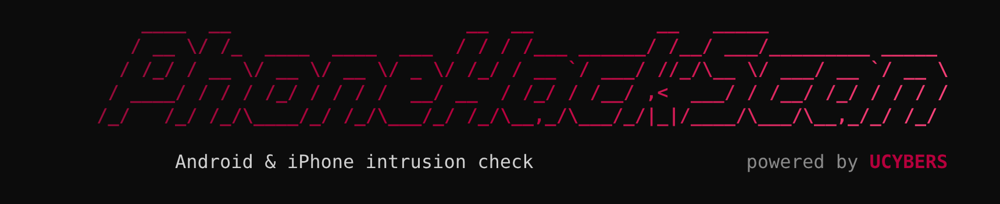
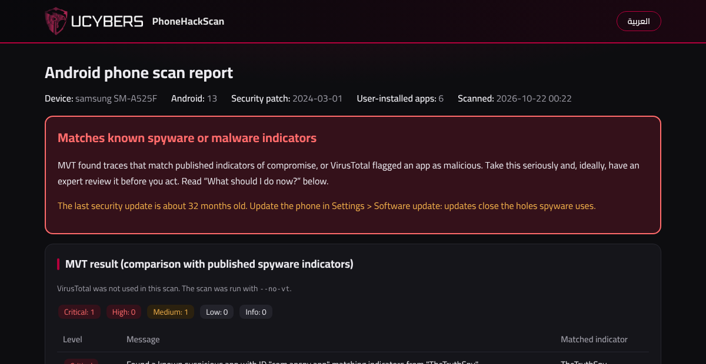

<p align="center">
  
</p>

<p align="center">
  <b>Android &amp; iPhone intrusion check</b> · powered by <a href="https://ucybers.com"><b>UCYBERS</b></a>
</p>

<p align="center">
  <a href="https://github.com/ucybers/PhoneHackScan/releases"></a>
  <a href="LICENSE"></a>
  
  
  
</p>

<p align="center">
  
  
  <a href="https://github.com/ucybers/PhoneHackScan/stargazers"></a>
</p>

<p align="center">
  <a href="https://ucybers.com"></a>
  <a href="https://discord.gg/FXgT8fdGyY"></a>
  <a href="https://x.com/UCybersX"></a>
</p>

<p align="center">
  <a href="#install">Install</a> ·
  <a href="#prepare-the-phone">Prepare the phone</a> ·
  <a href="#usage">Usage</a> ·
  <a href="#privacy">Privacy</a> ·
  <a href="#license">License</a>
</p>

PhoneHackScan checks an Android phone or an iPhone for signs of spyware and hacking, such as Pegasus, Predator and stalkerware. It gives you a clear report in English and Arabic, with one click to switch between them. It runs on Windows, macOS and Linux.

## What it checks

**Android (over USB)**

- **Quick check:** device admin apps, accessibility services, notification readers, keyboards, VPN and proxy settings, and hidden or sideloaded apps.
- **Full scan:** androidqf collects data from the phone, then MVT compares it with published indicators of compromise.
- **VirusTotal (optional):** only the file hashes of your own apps are looked up. The files themselves are never uploaded.
- **Intrusion Logging (Android 16):** analyses the logs you download from the phone.

**iPhone:** MVT analyses an encrypted computer backup. The backup is decrypted temporarily, and after the scan the tool offers to delete the decrypted copy.

**Report:** a dark page in English and Arabic with the verdict, what to do next, and beginner-friendly steps to remove a suspicious app.

<p align="center">
  <br>
  <sub>Example report from test data</sub>
</p>

## Install

On the first run the tool downloads adb, androidqf and MVT by itself into a `phonehackscan` folder in your home folder, so it needs an internet connection the first time. Reports are saved in the same folder.

### Windows

Open **PowerShell** and run:

```powershell
# 1. Install Python and Git (skip any you already have)
winget install -e --id Python.Python.3.12
winget install -e --id Git.Git

# 2. Close PowerShell, open a new window, then download PhoneHackScan
git clone https://github.com/ucybers/PhoneHackScan.git
cd PhoneHackScan

# 3. Run it
.\phonehackscan.cmd
```

Without Git:

```powershell
Invoke-WebRequest https://github.com/ucybers/PhoneHackScan/archive/refs/heads/main.zip -OutFile PhoneHackScan.zip
Expand-Archive PhoneHackScan.zip -DestinationPath .
cd PhoneHackScan-main
.\phonehackscan.cmd
```

Next time, you can simply double-click `phonehackscan.cmd`.

### Linux (Debian, Ubuntu, Kali)

```bash
# 1. Install what the tool needs (USB access rules for Android + iPhone backup tools)
sudo apt update
sudo apt install -y git python3 python3-venv android-sdk-platform-tools-common libimobiledevice-utils usbmuxd

# 2. Download PhoneHackScan
git clone https://github.com/ucybers/PhoneHackScan.git
cd PhoneHackScan

# 3. Run it
python3 phonehackscan.py
```

On other distributions, install Git and Python 3.10 or newer with your package manager, then run steps 2 and 3.

### macOS

```bash
# Needs Homebrew (https://brew.sh)
brew install python git
git clone https://github.com/ucybers/PhoneHackScan.git
cd PhoneHackScan
python3 phonehackscan.py
```

### Update

```bash
cd PhoneHackScan
git pull
```

## Prepare the phone

**Android**

1. Open **Settings → About phone** and tap **Build number** 7 times to turn on Developer options.
2. Open **Settings → Developer options** and turn on **USB debugging**.
3. Connect the phone with a data cable (not a charge-only cable), unlock it, and tap **Allow** when it asks to allow USB debugging.

**iPhone**

1. Connect the iPhone with a cable, unlock it and tap **Trust**.
2. Make a backup with **Encrypt local backup** turned on: with the Apple Devices app or iTunes on Windows, or Finder on macOS. On Linux:
   ```bash
   idevicepair pair
   idevicebackup2 -i encryption on
   mkdir -p ~/iphone-backup && idevicebackup2 backup --full ~/iphone-backup
   ```
3. Keep the backup password: the tool asks for it to decrypt the backup. Apple cannot recover it.
4. On macOS, give your terminal app **Full Disk Access** (System Settings → Privacy & Security) so it can read the backup.

## Usage

Run the tool with no options to get a menu: 1) Android, 2) iPhone, 3) Android quick check.

On Windows use `.\phonehackscan.cmd [option]`. On Linux and macOS use `python3 phonehackscan.py [option]`.

| Option | What it does |
|---|---|
| *(none)* | Menu (Android / iPhone / quick check) |
| `--quick` | Quick Android check only (about a minute) |
| `--no-vt` | Full Android scan without VirusTotal |
| `--iphone [FOLDER]` | Analyse an iPhone backup (found automatically) |
| `--intrusion-logs PATH` | Analyse Android 16 Intrusion Logging files (.zip or folder) |
| `--open-app PACKAGE` | Open an app's page on the phone to review or uninstall it |
| `--package [AGE_KEY]` | Bundle the latest scan for a security expert, optionally encrypted with age |

## Privacy

- No phone data leaves your computer. Nothing is sent to any person or company.
- The tool only goes online to download the tools and the public indicator lists (Google, GitHub, PyPI). If you enable VirusTotal, it also sends app hashes there.
- MVT runs with network access off, so links found in your messages are never opened.
- No apps are installed and no settings or personal data are changed on the phone. During collection, androidqf copies a small helper program to the phone's temporary folder and deletes it when it finishes.

## Important

- If you think someone close to you is monitoring you, removing an app may alert them. Read the safety section of the report first. Free help is available from the [Access Now Digital Security Helpline](https://www.accessnow.org/help/).
- A clean result does not prove the phone is clean. The tool only finds what is already known and published.
- Only scan your own phone, or a phone whose owner has given you permission.

## Credits

- [MVT](https://github.com/mvt-project/mvt) and [androidqf](https://github.com/mvt-project/androidqf), from the Mobile Verification Toolkit project started by Amnesty International's Security Lab. Both are downloaded when the tool runs and are not included here.
- Android platform-tools (adb) from Google, also downloaded when the tool runs.
- The Cairo font is embedded in the report under the SIL Open Font License 1.1. The full licence text is at the end of `phonehackscan.py`.

## License

PhoneHackScan is free software under the GNU General Public License v3 ([LICENSE](LICENSE)), with additional attribution terms ([NOTICE](NOTICE)). In short:

- You may use, copy, modify and share it, including for commercial purposes.
- Every copy or modified version you share, free or paid, must keep **powered by UCYBERS** clearly visible in the start banner and in every report.
- If you share a modified version, publish its source code under the same license and give it a name other than PhoneHackScan.
- The names PhoneHackScan and UCYBERS and the UCYBERS logo are not licensed as trademarks.
