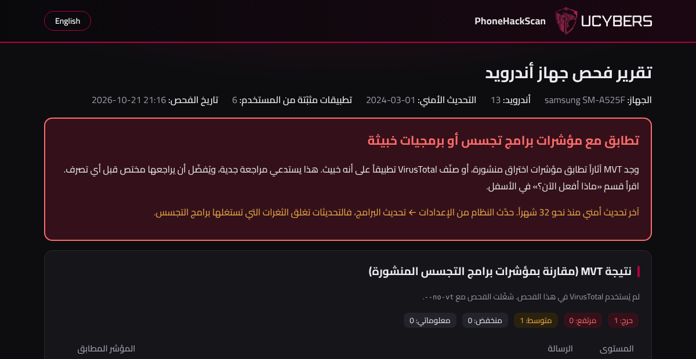

  

  <b>Android &amp; iPhone intrusion check</b> · powered by UCYBERS 
  <a href="#english">English below</a>

## PhoneHackScan

أداة مجانية تفحص هاتف أندرويد أو آيفون بحثاً عن آثار برامج التجسس والاختراق، مثل Pegasus وPredator وبرامج المراقبة (stalkerware). في النهاية تعطيك تقريراً واضحاً بالعربية والإنجليزية، وتنتقل بين اللغتين بضغطة زر.

تعمل على Windows وmacOS وLinux.

### ماذا تفحص؟

**أندرويد (عبر كابل USB):**

- **فحص سريع:** تطبيقات مسؤول الجهاز (Device admin)، خدمات إمكانية الوصول، التطبيقات التي تقرأ الإشعارات، لوحات المفاتيح، VPN والبروكسي، والتطبيقات المخفية أو المثبتة من خارج المتجر.
- **فحص كامل:** تجمع androidqf بيانات الهاتف، ثم يقارنها MVT بمؤشرات الاختراق المنشورة.
- **VirusTotal (اختياري):** ترسل الأداة بصمات ملفات تطبيقاتك فقط، وليس الملفات نفسها.
- **سجلات Intrusion Logging** في أندرويد 16.

**آيفون:** تحلل الأداة نسخة احتياطية مشفّرة للآيفون على الكمبيوتر بواسطة MVT. تُفك النسخة مؤقتاً، وبعد الفحص تعرض عليك حذف النسخة المفكوكة.

**التقرير:** صفحة داكنة بالعربية والإنجليزية تشرح النتيجة وماذا تفعل الآن، وكيف تحذف تطبيقاً مشبوهاً خطوة بخطوة.

### الخصوصية

- لا تخرج بيانات هاتفك من جهازك، ولا يُرسل شيء منها إلى أي شخص أو شركة.
- تتصل الأداة بالإنترنت فقط لتنزيل الأدوات وقوائم المؤشرات العامة من Google وGitHub وPyPI، ولـ VirusTotal إن فعّلته (وترسل له البصمات فقط).
- يعمل MVT والاتصال بالشبكة مغلق، فلا تُفتح الروابط الموجودة في رسائلك.
- لا تثبّت الأداة تطبيقات على الهاتف ولا تغيّر إعداداته أو بياناتك. أثناء الجمع تنسخ androidqf برنامجاً مساعداً صغيراً إلى مجلد مؤقت في الهاتف، وتحذفه عند الانتهاء.

### المتطلبات

- Python 3.10 أو أحدث من [python.org](https://www.python.org/downloads/). على ويندوز فعّل خيار Add python.exe to PATH أثناء التثبيت.
- اتصال بالإنترنت في أول تشغيل. تنزّل الأداة adb وandroidqf وMVT تلقائياً إلى مجلد `phonehackscan` داخل مجلد المستخدم، وتُحفظ التقارير في المجلد نفسه.
- **أندرويد:** فعّل خيارات المطوّر ثم تصحيح USB (USB debugging)، واستخدم كابل بيانات.
- **آيفون:** اعمل نسخة احتياطية مشفّرة عبر تطبيق Apple Devices أو iTunes على ويندوز، أو Finder على ماك، أو `idevicebackup2` على لينكس.

### التشغيل

- **ويندوز:** انقر مرتين على `phonehackscan.cmd`
- **ماك ولينكس:** شغّل `python3 phonehackscan.py`

تظهر قائمة فيها: 1) أندرويد 2) آيفون 3) فحص أندرويد سريع.

### تنبيه مهم

- إذا كنت تشك أن شخصاً قريباً منك يراقبك، فحذف التطبيق قد ينبّهه. اقرأ قسم الأمان في التقرير أولاً. يمكنك أيضاً طلب مساعدة مجانية من [خط مساعدة Access Now للأمن الرقمي](https://www.accessnow.org/help/).
- إذا لم تظهر نتائج، فهذا لا يعني أن الهاتف نظيف 100%. الأداة تكشف ما هو معروف ومنشور فقط.
- استخدم الأداة على هاتفك أنت، أو بإذن صاحب الهاتف.

   
  مثال على التقرير من بيانات تجريبية · Example report from test data

---

## English

PhoneHackScan checks an Android phone or an iPhone for signs of spyware and hacking, such as Pegasus, Predator and stalkerware. It gives you a clear report in Arabic and English, with one click to switch between them. It runs on Windows, macOS and Linux.

### What it checks

**Android (over USB)**

- **Quick check:** device admin apps, accessibility services, notification readers, keyboards, VPN and proxy settings, and hidden or sideloaded apps.
- **Full scan:** androidqf collects data from the phone, then MVT compares it with published indicators of compromise.
- **VirusTotal (optional):** only the file hashes of your own apps are looked up. The files themselves are never uploaded.
- **Intrusion Logging (Android 16):** analyses the logs you download from the phone.

**iPhone:** MVT analyses an encrypted computer backup. The backup is decrypted temporarily, and after the scan the tool offers to delete the decrypted copy.

**Report:** a dark bilingual page with the verdict, what to do next, and beginner-friendly steps to remove a suspicious app.

### Privacy

- No phone data leaves your computer. Nothing is sent to any person or company.
- The tool only goes online to download the tools and the public indicator lists (Google, GitHub, PyPI). If you enable VirusTotal, it also sends app hashes there.
- MVT runs with network access off, so links found in your messages are never opened.
- No apps are installed and no settings or personal data are changed on the phone. During collection, androidqf copies a small helper program to the phone's temporary folder and deletes it when it finishes.

### Requirements

- Python 3.10 or newer from [python.org](https://www.python.org/downloads/). On Windows, tick "Add python.exe to PATH" during setup.
- Internet on the first run. adb, androidqf and MVT are downloaded automatically into a `phonehackscan` folder in your home folder, and reports are saved there too.
- **Android:** turn on Developer options, then USB debugging, and use a data cable.
- **iPhone:** make an encrypted backup with Apple Devices or iTunes (Windows), Finder (macOS) or `idevicebackup2` (Linux).

### Usage

- **Windows:** double-click `phonehackscan.cmd`.
- **macOS / Linux:** run `python3 phonehackscan.py`.

A menu appears: 1) Android, 2) iPhone, 3) Android quick check.

| Command | What it does |
|---|---|
| `python phonehackscan.py` | Menu (Android / iPhone / quick check) |
| `python phonehackscan.py --quick` | Quick Android check only (about a minute) |
| `python phonehackscan.py --no-vt` | Full Android scan without VirusTotal |
| `python phonehackscan.py --iphone [FOLDER]` | Analyse an iPhone backup (found automatically) |
| `python phonehackscan.py --intrusion-logs PATH` | Analyse Android 16 Intrusion Logging files (.zip or folder) |
| `python phonehackscan.py --open-app PACKAGE` | Open an app's page on the phone to review or uninstall it |
| `python phonehackscan.py --package [AGE_KEY]` | Bundle the latest scan for a security expert, optionally encrypted with age |

### Important

- If you think someone close to you is monitoring you, removing an app may alert them. Read the safety section of the report first. Free help is available from the [Access Now Digital Security Helpline](https://www.accessnow.org/help/).
- A clean result does not prove the phone is clean. The tool only finds what is already known and published.
- Only scan your own phone, or a phone whose owner has given you permission.

  

## Credits

- [MVT](https://github.com/mvt-project/mvt) and [androidqf](https://github.com/mvt-project/androidqf), from the Mobile Verification Toolkit project started by Amnesty International's Security Lab. Both are downloaded when the tool runs and are not included here.
- Android platform-tools (adb) from Google, also downloaded when the tool runs.
- The Cairo font is embedded in the report under the SIL Open Font License 1.1. The full licence text is at the end of `phonehackscan.py`.

## License

PhoneHackScan is free software under the GNU General Public License v3 ([LICENSE](LICENSE)), with additional attribution terms ([NOTICE](NOTICE)). In short:

- You may use, copy, modify and share it, including for commercial purposes.
- Every copy or modified version you share, free or paid, must keep **powered by UCYBERS** clearly visible in the start banner and in every report.
- If you share a modified version, publish its source code under the same license and give it a name other than PhoneHackScan.
- The names PhoneHackScan and UCYBERS and the UCYBERS logo are not licensed as trademarks.

### الترخيص

PhoneHackScan برنامج حر بترخيص GNU GPL الإصدار 3 (ملف LICENSE)، مع شروط إضافية لذكر المصدر (ملف NOTICE). باختصار:

- يمكنك استخدامها ونسخها وتعديلها ومشاركتها، بما في ذلك الاستخدام التجاري.
- أي نسخة أو نسخة معدّلة تنشرها، مجاناً أو بمقابل، يجب أن تُبقي عبارة **powered by UCYBERS** ظاهرة بوضوح في شعار البداية وفي كل تقرير.
- إذا نشرت نسخة معدّلة، فانشر كودها بنفس الترخيص، وسمّها باسم غير PhoneHackScan.
- الاسمان PhoneHackScan وUCYBERS وشعار UCYBERS غير مرخّصة كعلامات تجارية.

النص الملزم هو النص الإنجليزي في LICENSE وNOTICE.

